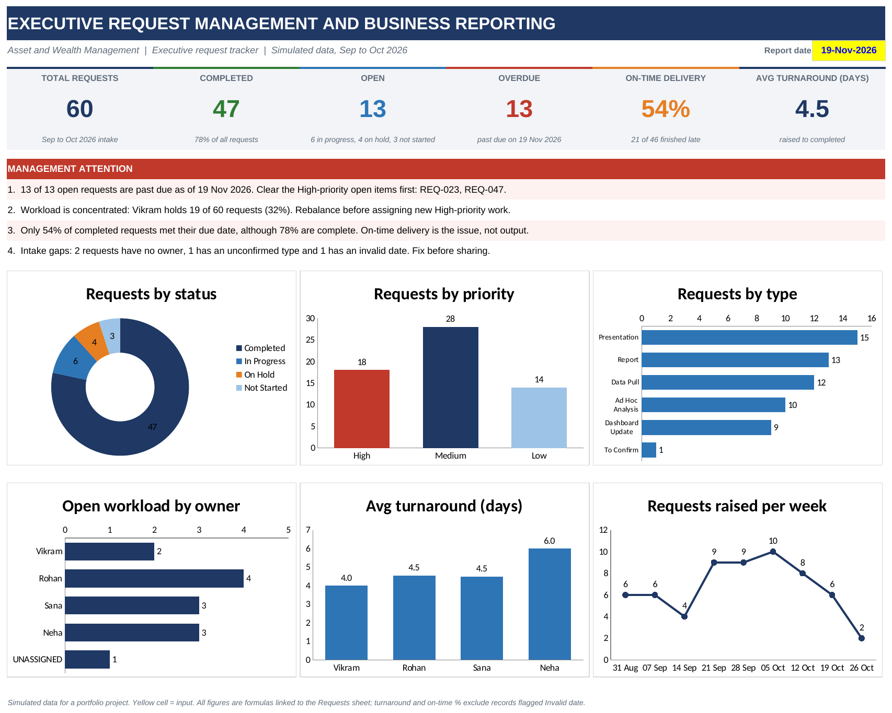

# ExecReady – Executive Request Management and Business Reporting

An Excel-based project for tracking executive requests, monitoring deadlines, reviewing workload distribution, and reporting delivery performance. The workbook brings request information and management insights together in one dashboard.



## Project Overview

Executive teams regularly receive requests for presentations, reports, data pulls, ad hoc analysis, and dashboard updates. Keeping track of these requests can become difficult when ownership, priorities, and deadlines are spread across different records.

I built ExecReady as an Excel-based request management and reporting tool. It brings these details into one place and helps identify overdue work, uneven workloads, and delays in delivery.

## Project Highlights

The following results are based on simulated request data, using a fixed reporting date of 19 November 2026.

| Performance Metric | Result |
|---|---:|
| Total Requests Tracked | 60 |
| Departments Covered | 5 |
| Assigned Request Owners | 4 |
| Confirmed Request Types | 5 |
| Completed Requests | 47 (78%) |
| Open Requests | 13 |
| On-Time Delivery Rate | 54% (25 of 46 valid completions) |
| Late Completions | 21 of 46 valid completions |
| Average Turnaround Time | 4.5 days |
| Records Flagged by Data Quality Checks | 4 |

**Key observation:** The completion rate is 78%, but the on-time delivery rate is only 54%. Looking at both measures gives a clearer picture of delivery performance.

## Key Business Findings and Recommendations

**1. Completion Rate vs. On-Time Delivery**

Although 78% of requests have been completed, only 54% of valid completed requests were delivered on time.

**Recommendation:** Monitor completion rates and on-time delivery separately rather than relying on completion figures alone.

**2. Overdue Requests Require Attention**

All 13 open requests are overdue as of the reporting date. Two of these requests, REQ-023 and REQ-047, have High priority.

**Recommendation:** Introduce a short daily review to identify urgent requests, check pending work, and follow up on overdue deliverables.

**3. Uneven Workload Distribution**

One request owner handles 32% of the total request volume, while two requests remain unassigned.

**Recommendation:** Review workload distribution and assign an owner to every request.

**4. Deadline Management and Turnaround Targets**

The results highlight the need to review how deadlines are set and how different request types are prioritized.

**Recommendation:** Establish realistic turnaround targets based on request type and priority.

**5. Improve Request Intake Controls**

The dataset contains missing owner information, one unconfirmed request type, and an invalid completion date.

**Recommendation:** Make owner, due date, request type, and priority required fields when recording new requests.

**6. Understand the Type of Requests Received**

Presentations account for 15 requests and reports account for 13. Together, they represent 28 of the 60 requests, or approximately 47% of the total workload.

**Recommendation:** Review the time and resources spent on presentations and reports when planning team capacity.

## Workbook Structure

The Excel workbook contains five worksheets.

| Worksheet | Purpose |
|---|---|
| Dashboard | Six KPI cards, a management attention section, and six charts. Designed to print on one landscape page. |
| Pivot Tables | Formula-driven summaries by status, priority, request type, owner, department, and week, including a reconciliation check. |
| Requests | Main request register with dropdown validation, conditional formatting, and calculated columns. |
| Insights | Six business findings with supporting figures, explanations, and recommended actions. |
| Read Me | Metric definitions, assumptions, documentation, and data quality log. |

## Data Quality and Validation

The original dataset required a few corrections before analysis.

| Issue Identified | Action Taken |
|---|---|
| Duplicate request ID (REQ-008) | The second occurrence was renamed REQ-015 to restore the request sequence. |
| Two missing request owners | Replaced with UNASSIGNED and flagged for review. |
| One missing request type | Replaced with To Confirm and flagged. |
| Invalid completion date (REQ-045) | Retained and flagged because the completion date precedes the raised date. Excluded from turnaround and on-time calculations. |

**Impact on reporting:** Including the invalid REQ-045 record would have reduced the average turnaround time from 4.5 days to 3.6 days. The record was therefore excluded from turnaround and on-time calculations.

## Technical Skills and Tools Demonstrated

**Microsoft Excel**
- COUNTIFS and AVERAGEIFS
- INDEX/MATCH
- Formula-driven PivotTable-style summaries
- Data validation and dropdown lists
- Conditional formatting
- KPI calculations and performance tracking
- Chart and dashboard development
- Data reconciliation and quality checks

**Business and Analytical Skills**
- Executive reporting
- Workload and priority analysis
- Deadline and turnaround monitoring
- Data quality assessment
- Business insights and recommendations
- Presentation development and documentation

**Additional Tool:** Microsoft PowerPoint

## Repository Structure

The project files are organised as follows:

```text
Execready-business-tracker/
│
├── README.md
├── .gitignore
│
├── ExecReady_Dashboard.xlsx
├── ExecReady_Dashboard_Snapshot.pdf
├── ExecReady_Presentation.pptx
│
├── ExecReady_Requests_cleaned.csv
├── ExecReady_Sample_Requests_original.csv
│
├── dashboard.png
└── data_dictionary.md
```

## Project Deliverables

- **Excel Workbook:** Request tracker, executive dashboard, reporting summaries, and business insights.
- **PowerPoint Presentation:** Eight-slide presentation covering the project and its findings.
- **PDF Dashboard Snapshot:** One-page dashboard export.
- **Data Dictionary:** Definitions of the dataset fields.
- **Sample Datasets:** Original and cleaned request data.

## Assumptions and Limitations

- All request records and performance figures are simulated and do not represent actual business data.
- The reporting date is a fixed input so that results remain consistent when the workbook is reopened.
- Summary tables are formula-driven rather than native Excel PivotTable objects. They update automatically when the underlying data changes.
- Invalid completion dates are flagged and excluded from relevant performance calculations.

## Author

**Krithika Gowda**
